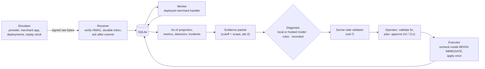

# RayTrace

**A merchant recovery workbench for paid-but-unconfirmed orders.** When customers have paid but their orders never confirm, RayTrace works out whether the payment provider failed or the merchant's own processing failed, and recovers only orders whose money was already captured: exactly once, on a plan a person approved. Everything runs on a fully synthetic payment sandbox.

**Live demo: [raytrace-demo.elishatom04.workers.dev](https://raytrace-demo.elishatom04.workers.dev)**: the real UI, replaying answers the API gave in rules mode for the three flows below. No login, no server, all data synthetic.

## For reviewers

| | |
|---|---|
| **Challenge track** | AI Revenue Recovery: recovering revenue from orders that were paid but never confirmed, without charging anyone twice. |
| **Try the live demo (steps to click)** | Open the [live demo](https://raytrace-demo.elishatom04.workers.dev) and click **Continue as op_demo_operator**. Under **Open run**, choose the `worker_backlog` run (Flow A). Then **Diagnose the latest incident**; in Recovery, validate the corrected handler `payload@5`, build the plan, refresh the stale-only orders and re-plan, **approve**, **execute**, and execute again (it replays, with no second effect). Open a recovered order's receipt. Then try `method_degradation` (Flow B: a provider failure, escalated, nothing reprocessed) and `late_authorization` (Flow C: an ambiguous payment, refreshed, then escalated). The guide at the top of the demo lists every step. |
| **The problem** | [Problem and demo](#problem-and-demo): a captured payment whose order stays unconfirmed. Asking the customer to pay again can collect twice; doing nothing leaves a paid order unfulfilled. |
| **Where AI is used, and where it is not** | Deterministic rules are the default: on a frozen 30-run test split they were right in 28 runs against the local model's 15. The model (`qwen3:8b`, local) is an optional investigator. It can only propose; a server-side validator checks every answer against its evidence packet, and only a person can approve the exact plan. See [Results](#results) and [How features were prioritized](#how-features-were-prioritized). |
| **Safety guarantees** | [17 invariants](#safety-and-correctness-invariants), each with where it is enforced and the test that checks it: raw-body signature checks, durable inbox, one fulfilment per order, approval bound to a plan hash, every precondition re-checked inside the write transaction. |
| **Reliability evidence** | 2,314 tests run in a network-less Docker container; release gates G01–G18; a stress and fuzz pass (16 simultaneous executes give 1 effect); a security audit. See [docs/RELEASE_VERIFICATION.md](docs/RELEASE_VERIFICATION.md) and [docs/SECURITY_AUDIT.md](docs/SECURITY_AUDIT.md). |
| **What broke and how it was fixed** | [Eight real incidents](#what-broke-and-how-it-was-fixed), from an approval that did not bind every field to a receipt hash that depended on unrelated data. |
| **Architecture** | [Architecture](#architecture) and [docs/ARCHITECTURE.md](docs/ARCHITECTURE.md); design decisions in [docs/DECISIONS.md](docs/DECISIONS.md). |
| **Run it yourself** | [How to run](#how-to-run): `uv sync --frozen`, then one command per flow; no model or API key needed. |
| **Stack** | Python 3.12, FastAPI, SQLite (WAL), React and TypeScript (Vite); optional local LLM through Ollama; Docker for tests. |
| **How it was built** | With AI coding agents under the author's direction, every phase verified independently: [How AI coding tools were used](#how-ai-coding-tools-were-used). |

## Problem and demo

> **Did the payment fail, or did our application fail to recognise a payment that succeeded?**

**The paid-but-unconfirmed order.** A customer pays and the payment provider captures the money, yet the merchant's order stays unconfirmed. The cause may be a worker that fails on the payment event, a receiver that rejects valid deliveries, or a payment authorised after it was first reported failed. Asking the customer to pay again can collect twice; doing nothing leaves a paid order unfulfilled.

RayTrace investigates and repairs that failure as an agent loop with bounded authority, for one simulated online merchant:

1. **Observe.** It gathers what was known at a cutoff into a bounded evidence packet: the provider's payment state, webhook deliveries, worker failures with stack traces, and deployments.
2. **Diagnose.** A model (`qwen3:8b` through Ollama, or a hosted OpenAI-compatible one) or a deterministic rules baseline names a cause and proposes one operation. The server validates the answer, which may cite only evidence in the packet.
3. **Verify.** For a worker fault, an allowlisted fix is tested against the real code in fixture tests, and deterministic code builds a plan naming the exact orders.
4. **Approve.** A person approves that plan's hash. Neither the model nor the rules can approve or execute anything.
5. **Act and prove.** The executor re-checks every precondition in one transaction, fulfils those orders in the local database, and writes a receipt of what changed.
6. **Loop.** An uncertain payment state is held, refreshed from the provider or escalated, never guessed.

Every step had to earn its place. In the frozen evaluation the rules baseline was correct in 28 of 30 runs, against the model's 15 (14 under strict scoring). So the demos and the UI run the rules, and the model stays an optional investigator. [How features were prioritized](#how-features-were-prioritized) shows each decision and its evidence. The code was written with AI coding agents under the author's direction, and every phase was verified independently ([How AI coding tools were used](#how-ai-coding-tools-were-used)).

**Everything here is synthetic.** There is no real money, no real customer and no real payment-provider account anywhere. The "provider", the merchant application, its deployments, its customers and their payments are all generated by this repository. Order and payment IDs carry a `SYNTHETIC` tag, and every run is stored with `environment = synthetic`; the settings refuse anything else.

**To see the demo,** install it and run [the three flows](#3-run-the-three-flows-end-to-end-with-the-rules-baseline-no-model-needed) with the rules baseline; no model is needed. [The three flows](#the-three-flows) shows what each prints, and [the one-page UI](#5-the-one-page-ui) lets you step through a run in a browser. The same page is hosted as a [recorded demo](https://raytrace-demo.elishatom04.workers.dev); [docs/DEPLOY.md](docs/DEPLOY.md) explains how it is built and hosted, and the live app's public mode.

## What it does

For each synthetic run, the workbench gives an operator:

- **A queue.** One case per order, with its state, blockers and next step, so captured orders whose processing never finished stand out.
- **Evidence.** A bounded packet of what was known at a cutoff: provider state, webhook deliveries, worker failures with stack traces, and deployments. It is stored with its hash, and a diagnosis may cite only its items.
- **Scoped approval.** A plan names the exact orders, their value and the evidence version they were judged on. A person approves that plan's hash, and the approval expires.
- **Local reprocessing.** The executor re-checks every precondition in one write transaction, then fulfils the approved orders in the local database. A second execute replays the record and changes nothing. No provider is called and nothing is charged.
- **A receipt.** Every execution, applied or rejected, has one, and regenerating it gives the same bytes.
- **Explicit unresolved states.** Unknown stays unknown. An order whose payment state is unresolved, conflicting or stale stays out of every plan, with its reasons shown.

### What executes and what is simulated

| Executes for real (the workbench) | Simulated (the sandbox around it) |
|---|---|
| Webhook receiver: HMAC-SHA256 over the raw bytes, durable SQLite inbox, acknowledgement after commit | The payment provider: payments, signed webhook deliveries (with retries, duplicates and conflicting redeliveries), snapshots |
| One worker running the deployed merchant handler, with bounded retries | The merchant application: an original tiny app in `fixtures/merchant_repo/` with code variants, real stack traces and diffs |
| As-of payment and order projection (late authorisation, conflicts, staleness, all attempts of an order) | Deployments of that app, logs, customers and orders, on a replay clock |
| Provider vs merchant measures, detectors and incidents | Traffic and the incident families used for evaluation |
| The evidence packet, the diagnosis (a local model through Ollama, an optional hosted model, or the rules baseline), the server-side validator | The provider-state refresh: a read-only adapter over the simulator's provider records |
| Fix validation (fixture tests run against real code variants), planning, approval, and the transactional executor | Money: integer paise in a synthetic ledger; no settlement and no real collection |
| The CLI, the HTTP API and the one-page UI | |

### The three flows

All excerpts are verbatim lines from the rules-mode runs in [How to run](#3-run-the-three-flows-end-to-end-with-the-rules-baseline-no-model-needed) (seed 101); some lines are omitted.

**Flow A: the payments succeeded and our worker failed.** The diagnosis names the faulting deployment, not the later innocent one. Then:

1. The operator validates an allowlisted corrected handler with the prewritten fixture tests.
2. A read-only provider refresh makes 5 stale-only orders eligible.
3. A person approves the exact plan, which then fulfils its orders once in the local database (a unique operation key and one write transaction enforce this).

```
    hypothesis: merchant_worker_regression; faulting change: deploy_9b85880366; affected method: none
    reproduced on the deployed handler: yes (failed ['captured_payment_builds_fulfilment', 'authorized_payment_changes_nothing', 'failed_payment_changes_nothing'])
    98 target orders, value INR 119,592.00
    103 target orders, value INR 125,027.00
[9] late authorisation: 4 late-authorised orders are in the plan
    each of these payments failed first and was captured later; the capture is real money already collected, so fulfilling the order restores processing and charges nobody again (new capture stays 0)
    action act_1d8d52903a0a6861d6af: succeeded; fulfilled 103 orders exactly once
    replayed: True; same action act_1d8d52903a0a6861d6af; fulfilments still 148 (were 148); no new effects
    restored processing value: INR 125,027.00 (money already captured before the intervention, not new revenue)
    new capture: INR 0.00
```

**Flow B: the same symptom, but one payment method is failing at the provider.** The diagnosis names the method and escalates; nothing is reprocessed.

```
    hypothesis: provider_method_degradation; faulting change: none; affected method: upi
    evidence level: supported (a label, not a probability); next check: compare_method_cohorts; proposed operation: escalate
[4] late authorisations
    10 payments first failed and later authorised (10 now captured); 10 of their 10 orders were already fulfilled
    a 'payment failed' recovery (asking the customer to pay again) would have collected twice for 10 of the captured payments
[5] escalate
    exception recorded (action act_f34b83ff31bf57145927) for ['upi']
    why not reprocess: the diagnosis is provider_method_degradation, and the operation policy permits only escalate for it; reprocessing is not among them
    no reprocessing: failed inbox rows 0, fulfilments unchanged
```

**Flow C: ambiguous payment state.** A failure is not final when payments were later authorised or are still unresolved. The workbench refreshes provider state read-only, including payments that failed in the last six hours, states what the late authorisations mean, and escalates.

```
    hypothesis: ambiguous_payment_state; faulting change: none; affected method: none
    evidence level: supported (a label, not a probability); next check: fetch_provider_snapshot; proposed operation: refresh_provider_state
[4] refresh (read-only provider snapshot)
    76 payments refreshed at replay time 1793880060000; statuses {'authorized': 3, 'captured': 10, 'created': 33, 'failed': 30}; unknown at provider 0
[5] late authorisations
    10 payments first failed and later authorised (8 now captured); 8 of their 10 orders were already fulfilled
    not fulfilled yet: order_SYNTHETIC_920abafa_0341, payments ['pay_SYNTHETIC_920abafa_00354']; its order is excluded for unresolved_attempt, not_captured
    not fulfilled yet: order_SYNTHETIC_920abafa_0351, payments ['pay_SYNTHETIC_920abafa_00364']; its order is excluded for unresolved_attempt, not_captured
[6] escalate
    why not reprocess: the diagnosis is ambiguous_payment_state, and the operation policy permits only escalate and refresh_provider_state for it; reprocessing is not among them
    no reprocessing: failed inbox rows 0, fulfilments unchanged
```

## How to run

Unless a command is marked otherwise, it was run for this README, in a clean copy of the repository against temporary data folders; `$RW` stands for the temporary folder and `…` marks omitted lines. [docs/RUNNING.md](docs/RUNNING.md) has each step's full output under the same number, and the evaluation commands, sending a webhook over HTTP, the production image (public mode) and the settings.

Requirements: Python 3.12 managed by uv, and Node 20.19+ or 22.12+ for the UI build. Ollama is needed only for the live local model.

### 1. Install

```console
$ uv sync --frozen
Using CPython 3.12.13
Creating virtual environment at: .venv
…
Installed 23 packages in 24ms
```

### 2. Seed one synthetic run and inspect it

```console
$ export RW=$(mktemp -d)
$ uv run python -m recovery_workbench.cli seed --scenario worker_backlog --seed 101 --data-dir "$RW/seed"
{
  …
  "run_id": "run_53966a08d4",
  …
}
$ uv run python -m recovery_workbench.cli status --run-id run_53966a08d4 --data-dir "$RW/seed"
…
```

Run IDs are neutral hashes. Use the `run_id` that `seed` prints. The same scenario and seed always give the same run.

### 3. Run the three flows end to end with the rules baseline (no model needed)

```console
$ uv run python -m recovery_workbench.cli demo --scenario worker_backlog --seed 101 --model-mode rules --data-dir "$RW/flow-a"
$ uv run python -m recovery_workbench.cli demo --scenario method_degradation --seed 101 --model-mode rules --data-dir "$RW/flow-b"
$ uv run python -m recovery_workbench.cli demo --scenario late_authorization --seed 101 --model-mode rules --data-dir "$RW/flow-c"
```

All three exit 0. Each prints numbered steps and writes a JSON report to `<data-dir>/reports/<run_id>.json`. Excerpts are in [The three flows](#the-three-flows).

### 4. Tests

The suite runs in a throwaway Linux container, so every database a test creates lives and dies inside it:

```console
$ scripts/test-in-docker.sh
…
2314 passed, 2 deselected, 1 warning in 455.41s (0:07:35)
```

- **Running without Docker.** `uv run pytest -q -m "not ollama"` runs the same suite on the host with the same counts.
- The 2 deselected tests call a live local model; run them on the host with `-m ollama` when Ollama is up.

### 5. The one-page UI

```console
$ npm --prefix frontend ci
…
$ npm --prefix frontend run build
…
$ WORKBENCH_MODEL_MODE=rules uv run python -m recovery_workbench.api --data-dir "$RW/api" --port 8000
RayTrace (synthetic sandbox) on http://127.0.0.1:8000/ ; execution mode rules
Model source: rules baseline (no model); set by WORKBENCH_MODEL_MODE=rules
Operator token for this server session (shown once): <printed here>
…
```

Open http://127.0.0.1:8000/, paste the operator token the server printed, and choose an operator ID such as `op_demo_operator`.

- The server listens on 127.0.0.1 only, unless public mode is on (see [Settings](docs/RUNNING.md#settings)).

### 6. Live local model, and recorded replay (optional)

Nothing above needs a model. The live mode runs `qwen3:8b` with thinking off (`WORKBENCH_MODEL=qwen3:8b`, `WORKBENCH_MODEL_THINK=false`), the model M0 chose ([Model](docs/RESULTS.md#model)), under prompt `diag-p5` and validator `val-7`.

The live mode needs [Ollama](https://ollama.com) on the same machine with `qwen3:8b`, listening on loopback only. **They were not run while writing this README**, because the model was busy with the frozen evaluation:

```bash
ollama pull qwen3:8b
ollama list
# keep the model listener local; skip if the desktop app already serves this port (configure it instead)
OLLAMA_NO_CLOUD=1 OLLAMA_HOST=127.0.0.1:11434 ollama serve
```

Then:

```bash
uv run python -m recovery_workbench.cli demo --scenario worker_backlog --seed 101 --model-mode local \
    --data-dir "$RW/live" --recordings-dir "$RW/recordings"
uv run python -m recovery_workbench.cli demo --scenario worker_backlog --seed 101 --model-mode recorded \
    --data-dir "$RW/replay" --recordings-dir "$RW/recordings"
```

- Use `WORKBENCH_MODEL_MODE=local` for the live model, `hosted` for a hosted one, or `auto` for the first that can serve (see [Settings](docs/RUNNING.md#settings)).
- Recorded replays are labelled `RECORDED` in the page, and hosted answers `HOSTED`, outside the M4 evaluation. The top bar names the model source the server chose at start. When a diagnosis needs review because the model was unavailable or failed, the page offers **Diagnose with the rules instead**.
- [docs/RUNNING.md](docs/RUNNING.md#6-live-local-model-and-recorded-replay-optional) records the last live runs of these two commands, and two guard paths: an unavailable model gives a visible `needs_review`, never an invented answer, and recorded mode replays only an identical model input.

## Architecture

The model, when one is used, only proposes. Deterministic code builds the evidence packet, validates every answer, chooses the exact orders and re-checks every precondition inside the write transaction that applies the effect. Only a person can approve a plan.



See [docs/ARCHITECTURE.md](docs/ARCHITECTURE.md) for the components, the SQLite tables, the trust boundaries and the decisions and cuts. The packet contract is in [docs/PACKET_SCHEMA.md](docs/PACKET_SCHEMA.md).

### Safety and correctness invariants

These are the 17 non-negotiable invariants. Each row names where the invariant is enforced and at least one test that checks it. All names were checked by grep against this repository.

| # | Invariant | Enforced in | Tested in |
|---|---|---|---|
| 1 | Verify raw webhook bytes before payload-driven business updates | `ingestion.receive_webhook`: `_signature_problem` (HMAC-SHA256 over the unchanged bytes) runs before `parse_payment_event` | `tests/test_ingestion.py` (`test_a_bad_signature_changes_no_business_state`), `tests/test_spike_port.py` (`test_02_mutated_raw_body_rejected`) |
| 2 | Event uniqueness and business-operation uniqueness are separate constraints | `storage.py`: `webhook_inbox` UNIQUE (run, integration, event ID); `fulfilments` PRIMARY KEY (run, order); `actions.operation_key` UNIQUE | `tests/test_spike_port.py` (`test_07_different_events_one_business_effect`), `tests/test_storage.py` (`test_one_final_fulfilment_per_order`) |
| 3 | Acknowledgement follows durable receipt; processing occurs separately | `ingestion._commit_receipt` commits before any 2xx; `ReceiptNotDurableError` is never acknowledged; `worker.run_worker` processes committed rows separately | `tests/test_ingestion.py` (`test_a_failed_commit_is_never_acknowledged`), `tests/test_worker.py` (`test_a_worker_killed_before_commit_leaves_the_work_pending`) |
| 4 | A payment can be observed failed and later authorised | `state._has_late_authorization` flags it. Since policy-v3 a late-authorised payment that is its order's only capture is reprocessed: fulfilled once, new capture 0. A second capture on the same order (`multiple_captures`) still blocks, and an uncaptured late payment is never a target | `tests/test_state.py` (`test_a_failure_followed_by_capture_is_a_flagged_late_authorisation`), `tests/test_executor.py` (`test_a_late_authorised_capture_is_fulfilled_once_with_no_new_capture`), `tests/test_plans.py` (`test_a_late_authorised_order_with_a_second_capture_stays_out`) |
| 5 | Older observations cannot erase valid capture evidence | `state.project_payment` | `tests/test_state.py` (`test_an_old_event_cannot_undo_a_capture`, `test_a_later_non_capture_observation_never_erases_capture`) |
| 6 | Same-time contradictory statuses are a conflict; event-ID order never decides meaning | `state.project_payment` records a conflict reason | `tests/test_state.py` (`test_same_time_contradiction_is_a_conflict_whatever_the_ids`, `test_same_time_contradictory_webhooks_block_the_order`) |
| 7 | A reused event ID with different bytes is stored and acknowledged but never processed automatically | `ingestion._hold_conflicting_delivery` (table `conflicting_deliveries`); the worker never claims it | `tests/test_ingestion.py` (`test_a_reused_event_id_with_different_bytes_is_held_and_acknowledged`), `tests/test_worker.py` (`test_a_conflicting_redelivery_is_never_processed_automatically`) |
| 8 | Only evidence available as of the diagnosis cutoff is visible to tools and the model | `tools.scope_for` / `tools.ToolScope`, as-of reads in `metrics.load_run_view` and `storage.py`, `packet.build_packet` | `tests/test_packet.py` (`test_an_earlier_cutoff_sees_less_and_never_the_future`), `tests/test_tools.py` (`test_recent_changes_and_metrics_only_see_what_was_known_by_the_cutoff`) |
| 9 | All payment attempts for an order are considered before recovery | `state.load_order_projection` (order-level exclusions), `policy.assess_target` | `tests/test_state.py` (`test_an_unresolved_other_attempt_is_excluded`, `test_multiple_captures_are_excluded`) |
| 10 | Monetary arithmetic uses integer paise | `contracts.Paise` (strict `int`), `CHECK (amount_paise > 0)` columns in `storage.py` | `tests/test_storage.py` (`test_money_is_positive_integer_paise`) |
| 11 | Unknown status stays unknown; missing evidence does not become a failure label | `state.project_payment` | `tests/test_state.py` (`test_nothing_visible_is_unknown_never_failed`, `test_a_missing_snapshot_remains_unknown`) |
| 12 | The model cannot approve an action, broaden run/merchant scope or cite evidence outside its packet | `diagnosis.build_response_schema` (per-packet ID enums) and `diagnosis.validate_diagnosis`; `tools.validate_tool_call` (the server injects run, merchant and cutoff); `executor.approve_plan` (human `op_` IDs only); `api.py` takes the operator from the session | `tests/test_diagnosis.py` (`test_schema_enums_are_exactly_this_packets_ids`, `test_validator_rejects_contract_violations`), `tests/test_tools.py` (`test_the_phase_one_allowlist_still_refuses_injected_scope`), `tests/test_executor.py` (`test_only_a_human_operator_can_approve`), `tests/test_api.py` (`test_a_model_cannot_become_an_operator`) |
| 13 | Approval binds to a plan hash and current evidence; preconditions are rechecked inside the same write transaction as the effect | `executor.approve_plan`, `executor.execute_plan`; `policy.recheck_reprocess` inside `storage.write_transaction` (`BEGIN IMMEDIATE`), which also checks each stored target's event ID, payment, amount and currency against its event | `tests/test_executor.py` (`test_approval_refuses_a_hash_the_operator_did_not_review`, `test_a_cancellation_after_approval_invalidates_the_plan`, `test_a_target_field_altered_after_approval_refuses_the_plan_on_that_target_alone_and_changes_nothing`), `tests/test_spike_port.py` (`test_18_approval_rechecks_state`) |
| 14 | Internal reprocessing is not provider webhook replay or a new payment | `executor.execute_plan` writes local fulfilments (`via = 'reprocess'`) only; `plans.prepare_provider_replay` returns instructions and makes no provider call | `tests/test_executor.py` (`test_capture_accounting_is_untouched_by_reprocessing`), `tests/test_plans.py` (`test_replay_lists_provider_captures_that_never_reached_the_inbox`) |
| 15 | Captured money is not automatically settlement, recognised revenue or incremental recovery | `metrics.restored_processing_value` and `metrics.capture_change` are reported separately; `report.py` outcome | `tests/test_spike_port.py` (`test_22_restored_processing_is_not_new_capture`), `tests/test_executor.py` (`test_restored_value_is_the_eligible_sum_and_new_capture_is_zero`) |
| 16 | Recorded model output is visibly distinguished from fresh inference | `diagnosis_store.StoredDiagnosis.mode_label`; replay only for an identical packet and prompt; RECORDED badge and banner in the UI | `tests/test_diagnose_incident.py` (`test_recorded_mode_replays_only_an_identical_packet`), `tests/test_api.py` (`test_a_recorded_replay_is_labelled_as_recorded`) |
| 17 | Provider replay never targets a blocked order | `plans.prepare_provider_replay` judges each capture's order on the reprocess planner's exclusions first, and holds a blocked one with its reasons | `tests/test_plans.py` (`test_replay_holds_every_capture_whose_order_the_reprocess_planner_would_exclude`, `test_replay_holds_the_d3_captures_whose_older_attempt_is_stale`), `tests/test_order_cases.py` (the fresh-world sweep) |

## Results

### Frozen research results

Each result below is frozen: it was measured under the settings it names, and later changes to the product do not re-score it. [docs/RESULTS.md](docs/RESULTS.md) has the full sections with their setups, caveats and raw files; the M4 tables by family and variant are in [evaluation/summary.md](evaluation/summary.md).

- **M0, choosing the model.** `qwen3:8b` passed the gate with no margin: 8/10 hypotheses correct at 7.2 s warm, with thinking off. `qwen3:4b` failed (7/10, with 3 unsafe proposals).
- **M4: the rules were stronger overall.** On the frozen TEST split (30 runs, six families × 5; `diag-p2`, `val-4`, `rules-v2`), outcomes were correct in 28/30 runs for the rules and 15/30 for the model (14/30 under a strict reading). The model's one advantage was the 2 delayed-onset D1 runs (rules 0/2, model 2/2). Across 15 recovery attempts there were 0 executed errors, 0 new capture and 0 duplicate fulfilments: an observed count, not a guarantee.
- **Planted instructions.** An instruction planted in an order note or a commit message gained no authority and no tool, but it moved the live model: over 50 live diagnoses, correct outcomes fell from 24 to 18 of 30 pairs.
- **Round 2, validator `val-5`.** On 25 fresh worlds, correct outcomes rose from 26/55 to 30/55, and `needs_review` from 0 to 5. The pre-registered verdict: helps.
- **Round 3.** Fencing the commit message had no detectable effect in this sample. Validator `val-6` helped, and so did removing commit messages from the model's input (induced blame 9 → 1, p = 1/64, Holm); both were adopted.
- **Phase 11b.** On held-out fault variations, sending attribution questions to the model named more wrong deployments than the deterministic `rules_v3` (19 against 16, over all 116 answers). The product stays rules-first, and rules mode now answers `rules_v3`.

### Release verification

The checks run on this release are reported apart from these research results, in [docs/RELEASE_VERIFICATION.md](docs/RELEASE_VERIFICATION.md). On the tested revision every acceptance gate (G01–G18) passed, and the three demonstrations (a recovery, a stale approval refused, an unresolved payment held) worked from fresh data with no model. One gap the verification found, under G07, was fixed first.

## What broke and how it was fixed

Each of these was found by a test, a probe or a review, fixed with a regression test, and re-verified.

- **The diagnosis lost its trigger.** In two development runs a card-authorisation drop opened the incident and then stopped firing before the diagnosis cutoff, so the evidence packet showed no signal and the rules missed the cause. Fix: the packet gained `ev_trigger.fired_since_open`, built from the incident's own detector history as known by the cutoff (packet version `pkt-2`, `tests/test_packet_history.py`).
- **A startup race on new databases.** Several connections opening a fresh SQLite file at once could fail while switching it to WAL mode: 15 and 23 failures in 4,800 connections. Fix C1 retries only on SQLite's busy or locked codes, with a deadline, and never applies a migration twice. Re-probed for the release: 0 of 4,800 failed, against 22 of 4,800 for a control without the fix.
- **Approval did not bind every target field.** The release gates (G07) found that the pre-execution recheck compared a stored target with its webhook event by order ID only, while the executor wrote from the stored payment, amount and currency. A target altered in the database after approval would have executed. Fix: the recheck compares each target's event ID, payment, amount and currency, and a difference fails `target_ineligible`. Before the fix 3 of 3 altered-target cases executed; after it, 0.
- **The receipt hash depended on unrelated runs.** The same recovery hashed differently depending on which runs had been seeded earlier in the database, because inbox row numbers leaked into the hash. Fix (receipt-2): the hash uses each row's rank, sorts observations, and states what it covers in its `hash_rule`. Flow A now hashes to `eb9d6f30…` however the database was filled.
- **A resent body was accepted as new.** A validly signed body resent under a new event ID was stored as a second event. Fix: the same bytes under a new ID are a duplicate, acknowledged with no second effect (migrations 4 and 5); a reused ID with different bytes is held and never processed automatically.
- **The server kept reading an oversized upload.** A real-server test showed that after answering 413, uvicorn went on draining the rest of the body. Fix: the route closes the connection when the body reaches the ceiling.
- **A flaky as-of test.** A test comparing a world cut at time *t* with the whole world compared a wall-clock latency field (0 against 1–3 ms). The comparison now leaves it out, and the queue never reads it.
- **The model was measured, and lost.** On the frozen test split the rules were correct in 28 of 30 runs and the model in 15, and planted instructions moved the live model. So the product runs rules first, the model only proposes, and validators `val-5` to `val-7` shipped only after pre-registered measurements ([docs/RESULTS.md](docs/RESULTS.md)).

The security audit's findings, each fixed or accepted as a listed limit, are in [docs/SECURITY_AUDIT.md](docs/SECURITY_AUDIT.md).

## Boundaries

Everything here is synthetic (see [Problem and demo](#problem-and-demo)), and the settings refuse any other environment and any external action. Within that sandbox:

- **The local order effect only.** A recovery changes only the workbench's own SQLite database: it fulfils the approved orders, marks their inbox events processed and records the action. An order can have at most one fulfilment there, the plan's unique operation key turns a second execute into a replay, and the re-check and the writes share one transaction. Nothing beyond that is claimed: nothing is sent to a provider or a customer, and the restored processing value is money already captured, not new revenue.
- **No live payment gateway.** Every provider interaction is simulated. No charge, refund, payout or customer message can happen.
- **One merchant, one currency (INR), three payment methods,** one worker and one application process.

**The optional model's limits:**

- **Some legal-but-wrong diagnoses still pass the validator, and some outside text still reaches the model unfenced.** The planted-instruction study found both.
  - The details are in [docs/RESULTS.md](docs/RESULTS.md#known-gaps-in-the-defences).
- **val-7's live effect rests on one trigger.** Offline it refuses 43 stored answers that `val-6` accepted, 41 of them naming the right deployment. Under the application's own settings (greedy decoding, `diag-p5`) its pre-registered measurement saw it refuse an answer `val-6` accepts once in 70 packets, and the one repair call recovered that answer (`experiments/val7_repair/`). Under sampled decoding it would fire more often, and its repair rate there is unmeasured.
- **Small samples.** M0 is 10 packets. The evaluation is 48 runs (18 development, 30 frozen test) over six families, and some variants have only a few runs.
- **The model is not fully deterministic** (see [Model](docs/RESULTS.md#model)). The diagnosis is one structured call over a fixed packet.

**Known issues:**

- **A capture the receiver acknowledged but never stored is recognised only through the provider's delivery log.** Before replay instructions, the workbench reads the simulated provider's delivery log; such a capture is held, and its order goes to manual review. The plain refresh does not read the log. That a real provider exposes per-event delivery attempts through an API is a dated assumption.
- **A late authorisation whose webhooks were all lost is found only by a re-check.** The read-only refresh, and the re-check before provider-replay instructions, ask the provider again about payments that failed within the packet's 6-hour look-back: newest first, at most 150. It misses older failures and payments nobody refreshes, and a capture it surfaces can still be refused by the provider's resend if the provider recorded a 2xx.
- The order queue is computed per request, for the whole run: about 0.14 s for 1,000 orders and up to 0.19 s for 1,300. The page reads it at the replay clock only; the API also answers for an earlier replay time.
- **A hostile program running under another account on this computer can still do three things** ([security audit](docs/SECURITY_AUDIT.md), findings 7–9; accepted as known limits). A program under the operator's own account needs none of them: it could already read the data directory or stop the server.
  - The three are described in [docs/RUNNING.md](docs/RUNNING.md#known-issues-when-running-it).
- **Sustained signed sending slows every reprocess plan build.** A plan build re-reads every unprocessed signed capture of the run, including those naming orders the run doesn't have, while it holds the process-wide lock. Each 65 KB capture adds about 1.5 ms to every later build, so a program sending thousands with the published fixture key slows each build by seconds, and other requests wait meanwhile ([security audit](docs/SECURITY_AUDIT.md), finding 10, low; accepted as a known limit). The similar slowdowns in findings 11–13 are fixed.
- **The webhook route is a sandbox receiver.**
  - Its limits are listed in [docs/RUNNING.md](docs/RUNNING.md#known-issues-when-running-it).
- **Sessions and jobs are in memory.** Operator sessions in loopback mode do not expire until logout or restart (public mode ends them after 30 idle minutes or 8 hours); diagnosis jobs are lost on restart (stored diagnoses are not), and the server keeps only its 64 newest finished jobs: an older job's ID answers 404, while its diagnosis stays in the run's list.
- **Not tested:**
  - a run with the network switched off after the downloads;
  - the UI check from a logged-out browser.
- **The UI has one light theme and no unit-level frontend tests.** At 1280 px and wider the open case sits beside the queue; from 768 px the cards stack; below that the page is one column, and wide tables scroll inside their own box. Motion is limited to state changes and is off under `prefers-reduced-motion`. These layouts were checked in headless Chromium at 1440, 1024 and 390 px, not in other browsers or on real phones. The browser walkthrough (885 checks) lives in `scripts/ui-walkthrough/` and runs in Docker with no network.
- **The rules baseline's rationale text prints raw epoch milliseconds.**

## Why this scope

The cuts are deliberate. [docs/ARCHITECTURE.md](docs/ARCHITECTURE.md#5-decisions-and-feature-cuts) gives each decision with its reason and the alternative it rejected, including why there is no agent framework, MCP runtime or vector database. Live gateways, and anything that moves real money, are left out by design (see [Boundaries](#boundaries)).

- **Five of the six stretch items in the original plan are not built** (the plan's numbering):
  - item 1, the bounded tool loop: its plan condition, M0 next-check agreement of at least 8/10, was not met (7/10);
  - item 3, dependency-graph and runbook-retrieval tools;
  - item 4, Flow B recovery (alternate-method invitations);
  - item 5, a payload-shape check against a gateway's test mode;
  - item 6, a static evidence viewer, hosting and server-sent events. A static recorded demo of the whole page now exists (`scripts/demo/`, see [docs/DEPLOY.md](docs/DEPLOY.md)), but there are no server-sent events.

  Item 2, the planted-instruction study, is built; see [Planted instructions](docs/RESULTS.md#planted-instructions-stretch-item-2).

### How features were prioritized

Core logic came first, and every AI feature sat behind a bar set before it was measured:

1. **The safety core.** The receiver and durable inbox, the worker, the as-of order projection, exact-plan approval and the transactional executor came first (v1). The order queue and the receipt came next, and the one-page UI was redesigned only after them.
2. **A model had to pass a gate.** M0 tried models on 10 packets. `qwen3:8b` passed with no margin (8 of 10), and `qwen3:4b` failed, with 3 unsafe proposals ([Model](docs/RESULTS.md#model)).
3. **The tool loop was cut by its own bar.** It needed next-check agreement of 8 of 10 in M0 and got 7, so it was not built.
4. **The evaluation set the default.** On the frozen M4 test split the rules baseline beat the model, so the product runs rules first ([M4](docs/RESULTS.md#evaluation-results-m4)).
5. **Defences shipped only on a pre-registered result.** Planted-instruction rounds 2 and 3 adopted validators `val-5` and `val-6`, and took commit messages out of the model's input. The fence they also tested showed no detectable effect, and the results say so ([round 2](docs/RESULTS.md#round-2-validator-val-5-on-fresh-seeds), [round 3](docs/RESULTS.md#round-3-fence-validator-and-strip-on-fresh-seeds)).
6. **Attribution stayed deterministic.** Phase 11b's pre-registered test found that the model named more wrong deployments than the rules, so rules mode answers with `rules_v3` ([phase 11b](docs/RESULTS.md#phase-11b-does-the-local-model-add-attribution-value-pre-registered-held-out-variants)).
7. **Fixed or listed, explicitly.** Each security finding was fixed or listed by a recorded decision ([docs/SECURITY_AUDIT.md](docs/SECURITY_AUDIT.md)). The release gates found one gap in approval binding, which was fixed before release ([docs/RELEASE_VERIFICATION.md](docs/RELEASE_VERIFICATION.md)).

Each design decision is logged in [docs/DECISIONS.md](docs/DECISIONS.md), numbered as the code's comments cite it.

### Why this problem

The scope is inspired by documented merchant problems and provider behaviour. The workbench calls no real provider, and none of these sources describes or endorses it.

- **Merchants report it.** A merchant case study on a payment provider's blog says that "Even when payments went through, confirmation delays were common." and that "this lack of instant reassurance led to duplicate payments, cancelled orders, and unnecessary support tickets." ([Find Your Kicks case study, 30 June 2025](https://razorpay.com/blog/?p=23374)). It is a company case study, not an independent evaluation, and it says nothing about the technical cause simulated here.
- **An acknowledgement is not a finished order.** Webhook delivery is asynchronous and at least once, with retries ([webhook best practices](https://razorpay.com/docs/webhooks/best-practices)). So a transport acknowledgement does not prove that the merchant finished processing.
- **A receiver must check what arrives.** Signatures are verified over the raw request body, retries of older requests may need the old secret, and duplicates and out-of-order delivery must be handled ([validating and testing webhooks](https://razorpay.com/docs/webhooks/validate-test)). Here, [invariants](#safety-and-correctness-invariants) 1, 2 and 5 to 7 cover the raw bytes, duplicates, late events and conflicting redeliveries.
- **Provider replay is a separate operation.** Replay does not send again events already acknowledged with a 2xx response, and the event ID stays the same across the original delivery and every replay ([replaying webhook events](https://razorpay.com/docs/webhooks/replay-events)). So restoring merchant processing from a durable local inbox is a separate operation from provider replay.
- **Failed is not final.** A payment marked failed after a bank timeout can later be marked authorised ([late authorisation](https://razorpay.com/docs/payments/payments/late-authorisation)). So uncertainty must not become proof of capture or permission to collect again.

## How AI coding tools were used

This repository was written with AI coding tools, and this section says how. The running record is [docs/AI_USE.md](docs/AI_USE.md).

- **Who wrote it.** The application code, the tests and the documentation were written by Claude coding agents (two sub-agents working on separate files). They worked under an orchestrating Claude Code session. That session wrote the contracts, settings and implementation guide, and verified every phase independently:
  - it re-ran every test suite itself and read the critical code paths;
  - it ran its own probes: label-leak scans, a read-only database probe, a black-box HTTP probe and a headless browser walkthrough of the UI;
  - it re-ran model results live;
  - it found and fixed a packet bug the agents had missed.
- **The author's role.** Elisha Tom set the goals, constraints and acceptance bars, made every product and scope decision ([docs/DECISIONS.md](docs/DECISIONS.md)), and reviewed the work.
- **Runtime AI is separate.** The local `qwen3:8b` model the app calls at runtime is product behaviour, measured in M0 and M4, not a coding tool. The M0 numbers above are live local inference, reproduced by the verifying session; they are not AI-authored claims.

## Licences and attribution

- **Project licence:** all rights reserved, copyright (c) 2026 Elisha Tom. No licence is granted: see [LICENSE](LICENSE). Access is for evaluating the work only.
- **Model:** Qwen3 (`qwen3:8b`; `qwen3:4b` in M0) is released under Apache-2.0 according to the upstream Qwen3 model card. It was not re-checked online for this README. The model weights are not part of this repository.
- **Python dependencies** (licences read from the installed packages' metadata):
  - FastAPI 0.162.4 (MIT);
  - Starlette 1.10.0 (BSD-3-Clause);
  - Uvicorn 0.54.0 (BSD-3-Clause);
  - Pydantic 2.14.3 and pydantic-core 2.50.4 (MIT);
  - HTTPX 0.28.1 and httpcore 1.0.9 (BSD-3-Clause);
  - AnyIO 4.16.0 (MIT);
  - pytest 9.2.0 (MIT, development only).
  - Exact versions are locked in `uv.lock`.
- **Frontend dependencies** (from each package's `package.json`):
  - React 19.3.1 and React DOM 19.3.1 (MIT);
  - Vite 7.3.8 (MIT);
  - @vitejs/plugin-react 5.2.0 (MIT);
  - TypeScript 5.9.3 (Apache-2.0);
  - @types/react and @types/react-dom 19.3.0 (MIT).
  - Exact versions are locked in `frontend/package-lock.json`.
- **Reused code:** no third-party code is vendored. The merchant fixture, the simulator and all data are original to this repository. `experiments/feasibility_spike.py` comes from this project's planning phase; it served as a design reference, and its design tests were ported in `tests/test_spike_port.py`.

## Repository history

RayTrace was built over 151 commits between 2026-11-11 and 2026-11-16 in a private repository, and published as a single commit. Commit IDs cited in the documentation and in the frozen research artifacts (for example "fixed in `578d394`" in the release verification) refer to that development history. The code each release check tested is identified by tree hashes in [docs/RELEASE_VERIFICATION.md](docs/RELEASE_VERIFICATION.md).

## Further reading

| Document | What it holds |
|---|---|
| [docs/ARCHITECTURE.md](docs/ARCHITECTURE.md) | Components, data flow, tables, trust boundaries, decisions and cuts |
| [docs/RUNNING.md](docs/RUNNING.md) | Every command with its full output, the live model's verification, the evaluation commands, webhooks over HTTP, the production image (public mode), the settings and the known issues of running it |
| [docs/RESULTS.md](docs/RESULTS.md) | The frozen research results in full: choosing the model (M0), the M4 evaluation, the planted-instruction study, rounds 2 and 3, phase 11b and the defences' known gaps |
| [docs/RELEASE_VERIFICATION.md](docs/RELEASE_VERIFICATION.md) | The release checks G01–G18, the three demonstrations, the stress and fuzz pass, and what they found |
| [docs/SECURITY_AUDIT.md](docs/SECURITY_AUDIT.md) | The security audit's runs, every finding and what was done about it |
| [docs/DECISIONS.md](docs/DECISIONS.md) | The design and scope decisions, numbered as the code cites them (`Q8`, `Q29`, …) |
| [docs/DEPLOY.md](docs/DEPLOY.md) | Sharing a free demo link: the static recorded demo, and the live app's public mode on a free host |
| [docs/PACKET_SCHEMA.md](docs/PACKET_SCHEMA.md) | The evidence-packet contract (pkt-2) |
| [docs/AI_USE.md](docs/AI_USE.md) | Where AI coding tools were used |
| [scripts/demo/](scripts/demo/) | `build-demo.sh <output-dir>`: the one-page UI as static files that replay the three flows' recorded API answers; `test-demo.sh` tests it in Chromium |
| [scripts/ui-walkthrough/](scripts/ui-walkthrough/) | `run-walkthrough.sh <output-dir>`: the UI driven in headless Chromium against two local API servers, in one Docker container with no network (885 checks) |
| [scripts/release/](scripts/release/) | The release gate test list and the three demonstrations behind the release verification |
