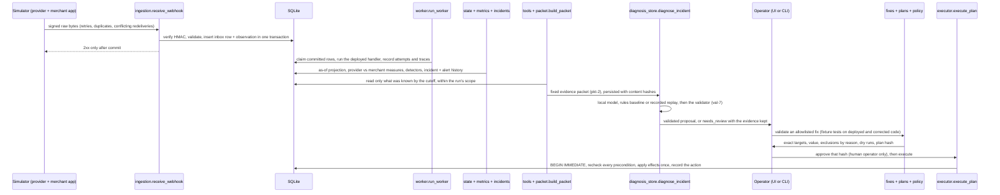

# Architecture and decisions

How the workbench is put together, where its trust boundaries are, and why it is built this way. For setup and the verified commands, see the [README](../README.md). The evidence-packet contract is in [PACKET_SCHEMA.md](PACKET_SCHEMA.md).

Everything runs locally in one Python process, plus a local Ollama server for the optional live model. Two opt-in settings are the exceptions. A hosted model, an OpenAI-compatible API reached over https, can answer diagnoses instead. Public mode (`WORKBENCH_PUBLIC_ORIGIN`) serves one https origin behind a host's proxy or a tunnel. With `WORKBENCH_MODEL_MODE=auto` it takes the local model if one answers on the same machine's loopback, else a configured hosted model, else the rules baseline; its production image has no local model. All data is synthetic.

## 1. Components

| Module | Responsibility |
|---|---|
| `contracts.py`, `settings.py` | Strict Pydantic contracts and enums; `WORKBENCH_*` settings that refuse a non-synthetic environment, external actions, or a non-loopback model URL |
| `storage.py` | SQLite schema and migrations, WAL mode, `write_transaction` (`BEGIN IMMEDIATE`), scoped and as-of queries |
| `ingestion.py` | Webhook receiver: size limit, HMAC-SHA256 over the raw bytes with the current secret or, during a rotation, the staged next one, payload validation, atomic inbox insert, acknowledgement after commit, conflicting redeliveries held for review |
| `worker.py` | Claims committed inbox rows, runs the deployed merchant handler, records each attempt (stack traces included), and retries on a bounded schedule |
| `state.py` | As-of projection of payments and orders: late authorisation, conflicts, staleness, refunds, cancellations, every attempt of an order |
| `order_cases.py` | The order recovery queue at a replay time: one case state, every blocker and the next step for each order, derived from observations only; served read-only by `GET /api/runs/{run_id}/orders` and `/orders/{order_id}` |
| `metrics.py`, `incidents.py` | Provider versus merchant measures (Wilson intervals), detectors (including signature rejections at an integration that still accepts deliveries), incidents and their alert history |
| `tools.py`, `packet.py` | Read tools under a server-injected scope; the fixed, bounded, cutoff-filtered evidence packet (pkt-2) |
| `diagnosis.py`, `diagnosis_store.py`, `rules.py`, `attribution_rules.py`, `selective.py` | Per-packet response schema, the local-model client (loopback only), the validator (val-7), stored diagnoses in four modes (`local`, `hosted`, `recorded`, `rules`, with `auto` choosing at start); the rules baseline. Rules mode runs `rules-v3` (`selective.rules_v3`): rules-v2's hypothesis and operation (`rules.py`) with the faulting deployment from `attribution-v1` (`attribution_rules.py`). rules-v2 alone is what the M4 evaluation runs. `selective.py`'s router and selective diagnosis are phase 11b's experiment and are not wired into the product |
| `fixes.py`, `plans.py`, `policy.py`, `executor.py` | Allowlisted corrected handlers and fixture validation; deterministic plans with dry runs; preconditions independent of the model; approval bound to the plan hash, and one transactional execution |
| `refresh.py` | Read-only provider-state refresh through an adapter (here the simulator's) |
| `report.py`, `cli.py`, `api.py` | JSON report export; the CLI and demo; the HTTP API with operator sessions, which also serves the UI |
| `simulator/` | The sandbox: provider, original merchant app (`fixtures/merchant_repo/`), deployments, traffic, scenario families, replay clock, oracle |
| `evaluation/` | Generator and runner for the frozen 48-run evaluation, rules versus model, scored against a hidden oracle |
| `frontend/` | One React + TypeScript page, built by Vite and served by `api.py` |

## 2. Data flow

One incident, from a provider delivery to a measured outcome:

Step by step:

1. **Receive.** `ingestion.receive_webhook` limits the body size and resolves the integration from the run's own configuration. It then:
   - verifies the HMAC over the unchanged bytes, with the integration's current secret or, while the merchant config live at receipt stages one for it, the next secret, and validates the payload;
   - inserts the inbox row and its payment observation atomically.

   A reused event ID with different bytes goes to `conflicting_deliveries`; it is acknowledged and never processed automatically. A verified body that the run and integration already hold under another event ID is a duplicate (migration 4): it is acknowledged, and nothing new is stored. A verified body the run and integration hold in `conflicting_deliveries`, arriving under a fresh event ID, is a duplicate too (migration 5): acknowledged, nothing stored, still held for review. If the commit fails, nothing is acknowledged.
2. **Process.** `worker.run_worker` processes committed rows with the merchant handler deployed at that replay time. Each attempt is a `worker_attempts` row with its exception category and stack trace. Fulfilment, order update and inbox completion share one transaction.
3. **Project and measure.** `state.py` projects payments and orders as of a time (`occurred_at` and `known_at` are both kept). `metrics.py` measures provider authorisation on mature cohorts and merchant processing of captured orders; detectors open incidents (`incidents.py`) and record every evaluation as alert history.
4. **Assemble evidence.** `packet.build_packet` uses the read tools in `tools.py`, whose run, merchant and cutoff are injected by the server, to build one bounded packet. It carries detector state and alert history, cohort metrics, provider state, delivery and worker health, the most common stack trace, the deployed handler's fixture results, deployments with bounded diffs, deduplicated logs and up to three order journeys. Nothing known after the cutoff is visible.
5. **Diagnose.** `diagnosis_store.diagnose_incident` stores the packet first, then diagnoses it in one of four modes (`auto`, resolved once at start, picks the local model if one answers on loopback, else a configured hosted model, else the rules; `model_source.resolve`):
   - the local model (`qwen3:8b` through Ollama), with a schema whose ID enums list only this packet's IDs, at most one repair call and a hard deadline;
   - the rules baseline, `rules-v3` (decision 9). A stored diagnosis keeps the rules version it was made with, and every display shows that version;
   - a recorded replay of an earlier local output for an identical packet and prompt;
   - a hosted model: an OpenAI-compatible API over https, with the same schema, validator and repair limit, a reply cap, strict JSON, and a daily call budget per process (`hosted_model.py`). Its answers are labelled HOSTED and sit outside the M4 evaluation.

   The validator re-checks citations, candidates, the operation policy, change consistency, fixture-reproduction claims and method naming. Since `val-5` it also checks that the hypothesis agrees with the alert history and with the worker evidence:

   - `no_incident` must explain every alert: the order-completion symptom always, and an unresolved-payment spike only when the packet shows an observation gap.
   - A worker regression needs a `worker_error` item.
   - Since `val-6` (phase 9): `unknown` may not name a faulting deployment, and `receiver_rejecting_deliveries` needs rejected deliveries in the packet's delivery health (`distinct_events_rejected` above 0, read fail-closed). Together with the worker rule, a named deployment now needs a merchant-side hypothesis backed by that hypothesis's signature evidence. `val-6` was adopted after round 3, whose pre-registered decision found that it helps: 16 benefits, 0 costs, and clause (a) behind 14 of the 15 wrong answers it sent to review.
   - Since `val-7` (adopted 2026-11-13): the rationale may name a deployment only by a candidate change ID, and a named faulting change needs an item cited as supporting that mentions it (its title, its text, or a fact key or string value). Both rules read the packet as stored. Unlike val-5 and val-6, val-7 judges citations, not the hypothesis; a pre-registered live measurement (`experiments/val7_repair/`) found it refusing an answer val-6 accepts once in 70 packets under the application's settings, and the repair recovered that answer.

   A refused answer gets one repair call. If it is refused again, the result is `needs_review`, not an invented answer.
6. **Validate a fix.** `fixes.validate_fix` runs the prewritten fixture tests against the deployed handler and an allowlisted corrected one, and records whether the failure was reproduced.
7. **Plan.** `plans.build_reprocess_plan` picks the exact orders, applies every exclusion and dry-runs the corrected handler on each target. Exclusions include stale snapshot, conflicts, cancellations, refunds, multiple captures, unresolved attempts and amount mismatch; a late authorisation alone is not one (decision 4). The result is a plan hash over the operation, the sorted targets, the evidence version, the policy version, the run and the expiry.
8. **Approve and execute.** `executor.approve_plan` binds a human operator's approval to that hash. `executor.execute_plan` opens `BEGIN IMMEDIATE`, re-checks every precondition (`policy.recheck_reprocess`), applies the effects once and records the action with before and after snapshots. A repeated execute is a pure replay; a changed precondition rejects the whole plan.
9. **Receipt.** Each reprocess plan records a plan audit, and each execution, applied or rejected, an action audit, in the same transaction (migration 3). `report.build_receipt` turns them, with the plan, approval, fix validation and diagnosis, into a deterministic receipt. It holds:
   - identity and versions;
   - the evidence: the observations and snapshot IDs each target was judged on, with their freshness;
   - the proposal and the approved operation;
   - preconditions at planning and at execution: every check, passed, failed or not run, as `policy.recheck_reprocess` reported it; a check it did not evaluate (without an approval, the approval's own three) is not run;
   - per-order results;
   - postconditions: captures unchanged, no duplicate fulfilment, outstanding exceptions;
   - the restored and unresolved values (the unresolved value covers this plan's candidate orders), and the boundary.

   Its hash covers everything except the random record IDs and stored wall-clock times; the export time is never part of it. It is served by the CLI `receipt` command and by `GET /api/runs/{run_id}/actions/{action_id}/receipt`, which also takes `?format=markdown`.

Escalation and provider-replay instructions (`plans.escalate`, `plans.prepare_provider_replay`) record what a person must do. They change no business state and call no provider. Replay applies the reprocess planner's order-level exclusions first: a capture whose order is blocked (a mismatch, multiple captures, a cancellation or refund, conflicting, stale or missing provider state, an unresolved extra attempt, or an existing fulfilment) is listed under `held_for_reconciliation` with the order's reasons, and is never a target. A resent event would reach the worker, which waits for no refresh.

10. **Queue.** `order_cases.classify_orders` gives every order one case state, all of its blockers and a next step, as of a replay time. The API serves it read-only:
    - `GET /api/runs/{run_id}/orders` gives whole-queue totals and coverage, and summary rows that filter by state, next step or blocker;
    - `GET /api/runs/{run_id}/orders/{order_id}` gives one case: its record, a provider → delivery/inbox → worker → order timeline built from the records it relied on, and links to the receipts of the reprocess actions that targeted it.

    Each request reads one snapshot, begun under `clock_lock`. A time after the replay clock is refused. No model is involved.

## 3. Storage

One SQLite file per data folder, in WAL mode. Every write goes through `storage.write_transaction`. Opening a new file switches it to WAL. While another connection is opening the same new file, SQLite refuses that switch at once instead of waiting, so the busy timeout does not cover it. `storage.connect` therefore retries the switch within the same 5 s budget, then fails with a `StorageError` naming the file (phase 9). The schema and migrations are in [`src/recovery_workbench/storage.py`](../src/recovery_workbench/storage.py).

| Table | Purpose |
|---|---|
| `runs` | One synthetic run: seed, scenario, split, generator version, replay clock, `environment = synthetic` |
| `integrations` | Per-run webhook integration: fixture secret reference (never the secret) and body-size limit |
| `orders` | Synthetic orders with integer-paise amounts, cancellation, refund and fulfilment state |
| `payment_attempts` | Every payment attempt of an order, with its method |
| `payment_observations` | Append-only provider observations (webhook or snapshot), with `occurred_at_ms` and `known_at_ms` |
| `webhook_inbox` | Durable verified events, unique per run, integration and event ID; processing status and attempts |
| `conflicting_deliveries` | A reused event ID with different bytes: stored, acknowledged, held for review, never processed |
| `provider_delivery_attempts` | The provider's webhook delivery log as read before a replay (migration 6): per attempt, the event and its payment, the time, the HTTP status the provider saw (NULL for a timeout), automatic or dashboard resend, and when the workbench read it. Append-only; not in the observable dataset hash |
| `delivery_attempts` | Every delivery attempt and its outcome (accepted, duplicate, rejected signature, schema or size) |
| `worker_attempts` | Every worker attempt: version, exception category, stack trace, result |
| `deployments` | Deployments of the merchant app known by a time: summary, files changed, bounded diff |
| `merchant_logs` | Synthetic merchant log lines (untrusted text) |
| `incidents` | Opened incidents: trigger, cohort, window, evidence cutoff |
| `evidence` | Detector findings (alert history) and persisted packet items, with content hashes |
| `diagnoses` | Stored diagnoses: mode, model and digest, thinking, prompt version, packet hash, output or reasons |
| `fix_validations` | Fixture results on the deployed and corrected handlers, the operator, whether it passed |
| `plans` | Deterministic plans: targets, value, evidence and policy versions, plan hash, expiry, status |
| `approvals` | Human approvals bound to a plan hash, with expiry |
| `actions` | Executed or rejected actions, unique per operation key, with before and after snapshots |
| `plan_audits` | Per reprocess plan, written with it: every candidate order (a target, or excluded with the preview's reasons), every dry run, superseded events, deployed and corrected versions. Append-only |
| `action_audits` | Per executed or rejected reprocess action, written in its transaction: every check and its result, the observations each target was judged on, per-order results, postconditions and amounts. Append-only |
| `fulfilments` | At most one fulfilment per order, by the worker or by an approved reprocessing action |
| `schema_migrations` | Applied migration versions |
| `sim_merchant_releases`, `sim_merchant_profiles`, `sim_provider_signing` | **Simulator-private:** which code variant each deployment shipped, and which provider secret signs from when (migration 1002). The workbench's tools and packet never read them (tested with an SQLite authorizer) |

## 4. Trust boundaries

| Boundary | Rule | Where |
|---|---|---|
| Untrusted text: log lines, stack traces, diffs, commit messages | Treated as data. In the prompt each text block is fenced as untrusted, and a copy of the end marker inside the text is removed. The system prompt says such text is never an instruction. The UI renders it as plain text, never HTML or Markdown. **Since prompt `diag-p3` (phase 9):** a deployment's summary (its commit message) no longer renders on the item's `facts` line, which the system prompt calls workbench measurements; it renders in a fenced block of its own. Every fence-marker-shaped string inside fenced text is removed, so untrusted text can neither close its own fence nor open or close another. Look-alike characters are not covered. **Since prompt `diag-p4` (adopted after round 3):** commit messages are removed from the model's input altogether. The deploy log's rollout line keeps its template with `[commit message removed]`. Round 3 found that the fence alone had no detectable effect, while removal reduced attack-induced blame (9 → 1, p = 1/64, Holm), with no net harm on clean cases. The planted-instruction study found the old exception, and M4 ran `diag-p2`. **Since prompt `diag-p5` (phase 10):** facts reach the model only through a field policy (`diagnosis.FIELD_POLICY`), one rule per item kind and facts path. Workbench numbers, booleans and codes render as typed values. Names from other systems (IDs, service names, file paths, top frames, payment methods, versions, log sources) render only if they match a strict identifier pattern. Codes from other systems (provider failure reasons and error sources, worker exception categories) render only if they are on an allowlist taken from the simulator's and the merchant fixture's code. A fixture check's failure detail, the merchant's exception message, renders only in a fenced block of its own. A fact without a rule is not rendered. A value that fails its check shows as `unlisted_<n>`; its raw text appears only in the item's fenced `unlisted values` block, as a JSON string with markers removed. On every stored packet the only change is the relocated failure details. **Still unchecked (a documented residual):** item titles, the incident card and the candidate deployment and method lines repeat some of these identifiers outside any fence. The order queue's case view shows each record's fields with `JsonText` and worker stack traces with `UntrustedText`; its receipt links are built from stored IDs, never from a URL a record supplies. | `diagnosis.render_packet`, `diagnosis.FIELD_POLICY`, `frontend/src/components/JsonText.tsx` |
| The model | It reads one rendered packet, without run or incident IDs, and returns one structured answer. It has no tools, no route to approve or execute, and cannot widen scope. Its citations must be IDs in the packet. Its proposal passes server-side policies, and blocked proposals are recorded as unsafe. Since `val-5` its hypothesis must also agree with the evidence; those refusals are fed back once, kept in the diagnosis's reasons, and are not counted as unsafe proposals. Targets, values and preconditions come from deterministic code. The CLI demo prints the rationale, and reasons that quote the endpoint, with each control or format character escaped (`report.visible`). | `diagnosis.py`, `tools.validate_tool_call`, `plans.py`, `policy.py` |
| The operator | A random token printed once at server start buys an httpOnly, SameSite=Strict session. Every request must name the loopback Host. Every request in a method other than GET, HEAD and OPTIONS, so every state change, also needs a same-origin `Origin`/`Sec-Fetch-Site` and, everywhere except the webhook route, the `X-Workbench-Request` header. The guard names the methods it exempts, so a route added with any other method fails closed. Every request body except a webhook delivery's is limited to 64 KiB (`MAX_REQUEST_BODY_BYTES`) before the session check and before login: a declared larger length answers 413 before any route runs, and a larger body sent without a length answers 413 at the read that passes the limit. A route that takes no body never reads one. **Residual:** as after the guard's 403, uvicorn then reads and discards whatever body the sender still sends. The operator behind validations, approvals and escalations comes from the session; approvals accept human `op_` IDs only. | `api.py`, `executor.approve_plan` |
| The webhook sender | Authenticated only by HMAC-SHA256 over the raw body, which `ingestion.receive_webhook` checks with the integration's current secret and, only while the merchant config live at receipt stages one for that integration (config@6's `NEXT_WEBHOOK_SECRET_REF`), with the staged next secret. No other secret verifies, and a delivery the staged secret verified says so in its attempt's `detail`; there is no operator session. The signature covers the body, not the event-ID header, so a verified body the integration already holds under another event ID is answered `duplicate` and stores nothing; the attempt's `detail` names the stored event. A resend therefore cannot refresh evidence; a first delivery that arrives late still can. The fixture secrets are published constants (`simulator/signing.py`), so the route trusts any local process as the provider. It listens on 127.0.0.1 only, and the Origin and Sec-Fetch-Site checks refuse browsers on other sites. The request guard waives only the `X-Workbench-Request` header, and only for `POST /api/runs/{run_id}/webhooks/{integration_id}`: a strict path pattern matched against `scope["path"]`, the path the router matches. Every request that reaches an existing run leaves a `delivery_attempts` row, rejected or not, whoever sent it, except a body the deployed receiver fails on before verification (500, recorded nowhere). That is by design: rejected deliveries are D3's evidence, and delivery health is per integration, so rejections for an unknown integration only take up rows. An unknown run answers 404 and records nothing. The body read stops at the ceiling plus one byte, and the connection then closes. A body nesting more than 32 levels of arrays and objects is refused before any parser reads it; one linear scan does it, with no recursion. Without that check, a validly signed body with a deeply nested ignored field was accepted, and the merchant handler's re-parse then failed and recorded worker failures: fabricated D1-style evidence. The deployed merchant receiver, which prepares the bytes the signature is checked against, reads a body only once the body is within the integration's size limit and that nesting limit; ingestion refuses any other body as sent. A sender that disconnects mid-body is logged as a warning and leaves no record. The route takes 600 deliveries a minute per process, answers carry only the outcome and event ID, and any storage failure answers 503 with `Retry-After`. **Residual:** other early answers leave the connection open, and uvicorn reads and discards whatever body the sender still sends. These are the guard's 403 and the 429, given before the body is read, and a 404 or 503 that follows a body cut short at the ceiling. The `webhook-request` helper signs with the provider's secret (`merchant.PROVIDER_SIGNING_REF`), never the receiver's. | `api.py`, `ingestion.py`, `cli.py` |
| The simulator and its oracle | Answer keys live in `fixtures/manifests/` and `<data-dir>/oracle/`; the code variant per deployment lives in `sim_*` tables. Tools and the packet never read either. The deployed handler is passed in by the caller (decision 2). | `tools.py`, `packet.py`, `tests/test_tools.py` |
| The provider adapter | A refresh calls the adapter outside any transaction, then checks the answer: no future state and no unrequested payments. Only then does it insert snapshot observations. | `refresh.py` |
| The network | The local model's URL must be loopback, and a hosted model's must be https (plain http only to a loopback host). The API binds to 127.0.0.1 by default; only opt-in public mode may listen on every interface (`--host 0.0.0.0`, as its production image does behind a host's proxy), and it then answers only its one https origin. External actions cannot be switched on. | `settings.py`, `api.py` |

## 5. Decisions and feature cuts

Each entry gives the decision and the reason, and names the alternative it rejected.

**1. A fixed evidence packet, not a tool loop.** Code assembles one bounded packet, and the model makes one structured call with at most one schema repair. This makes diagnoses deterministic in their inputs, cheap to bound (size, deadline) and directly comparable: the rules baseline reads exactly the same packet. M0 tested this setup. The bounded tool loop is the first stretch item. It is to be built only if it beats the fixed packet on the same frozen test, and it has not been built.

**2. Dependency injection for the deployed handler.** Which merchant code was live at a given time is simulator knowledge. `simulator.runtime.active_merchant` resolves it, and the caller passes the result into packet building, fix validation, plan dry runs, execution and the worker. The workbench modules that face the model (`tools.py`, `packet.py`) therefore never import the runtime or read its private tables. A static test and an SQLite authorizer test enforce this. The rejected alternative, letting tools look up the deployed variant, would have put the simulator's answer key one query away from the model's evidence.

**3. Strict models plus `SELECT *` as a drift alarm.** Every storage record is a Pydantic model with `extra="forbid"`, filled from `SELECT *` rows. A schema change made without its model fails loudly and at once, instead of silently dropping or mis-mapping a column. This happened once: an early migration attempt broke 126 tests and was rolled back. From then on, a schema change and its models are owned and changed together. The cost is that migrations are never "just add a column".

**4. A late-authorised capture is reprocessed.** Decided on 2026-11-12 ( "ideally reprocessed"). It replaces the first, conservative rule, which sent such orders to manual review.

- **The rule.** A payment that was first seen failed and was captured later is an ordinary reprocessing target when it is its order's only capture and nothing else excludes the order. The capture is money already collected, so fulfilling the order restores processing and charges nobody again; the plan's new capture stays 0.
- **Every other exclusion stays.** The one that matters here is `multiple_captures`. A customer who was told the first payment failed and paid again on the same order leaves a second capture, and that order stays out of every plan until a person refunds one.
- **Captured money only.** A late payment that is only authorised, not captured, is never a target. Planning fulfils captured money only, and beside a captured retry the uncaptured late payment keeps the order out as an unresolved attempt.
- **Recheck and version.** The in-transaction recheck still fingerprints every payment's late-authorisation flag, so a late authorisation that appears after planning invalidates the plan. The policy version moved to `policy-v3`, so a plan built under the old rule cannot execute under the new one.

**Residual risk.** A customer who re-ordered under a *new* order ID is invisible to the planner, whose guard only sees captures on the same order. If the first order's late capture is then reprocessed, that customer has paid for, and is sent, two orders. Catching that needs customer-level matching across orders, which this synthetic merchant does not model. The workbench has no refund tool, so such a case is left to a person outside it.

**5. pkt-2: the packet carries the incident's alert history.** In two development runs, a moderate method drop opened its incident and then stopped firing before the diagnosis cutoff. `ev_trigger.fired` was empty, and the rules baseline saw no signal. An on-call engineer would see the alert history, so the packet now carries `fired_since_open`: every detector that fired while the incident was open, from history known by the cutoff. A regression test reproduces the original run. See [PACKET_SCHEMA.md](PACKET_SCHEMA.md).

**6. Neutral run IDs.** Early demo run IDs named the scenario (`run_<scenario>_<seed>`), and evaluation IDs embedded family-numbered seeds. Both reached the model through the incident card. The leak was closed in two layers:

- the model-facing text no longer contains run or incident IDs (prompt `diag-p2`, with a test over the whole model request);
- run IDs are now hashes of the scenario key, split, seed and generator version (`run_<10 hex>`), and order and payment IDs carry a hash tag instead of the seed.

Tests read run IDs from the seed output instead of hard-coding them.

**7. The delayed-onset variant.** In the original worker-regression runs, failures began within about 30 s of the faulty deployment. The heuristic "latest deployment before the first failure", which the rules may use, therefore got every attribution right by construction. Real faults that only trigger on some inputs start late. So the evaluation adds a delayed-onset variant:

- the faulty deployment lands in a traffic lull;
- an innocent deployment that touches a file in the stack trace lands inside the same lull;
- failures begin only when traffic returns.

Timing alone then blames the innocent deployment, and naming the right one needs the stack trace and the diffs. The variant is reported separately, so the prompt-onset runs, where rules should win, stay in the results.

**8. No agent framework, MCP runtime or vector database.** There is one application, one worker, one structured model call per diagnosis, and a small fixed corpus per run. A framework would add an abstraction over a single call. A vector store would index a few kilobytes of evidence that the packet already includes in full. The project plan required a measured need before adding either, and none was found.

**9. Rules mode answers `rules-v3`.** Phase 11b's pre-registered decision 2 compared it with rules-v2 on 48 held-out worlds whose fault variants neither was built on: 38 correct and 8 wrong deployments, against 32 and 16.
- **What it is.** rules-v2's hypothesis, method, evidence level and operation, with the faulting deployment from `attribution-v1`. That comparator reads the same packet as the model, but never a commit message or a log line's text. Where the two disagree about the cause, the deployment becomes `unknown`. If the validator (`val-7`) still refuses the merged answer, rules-v3 escalates instead.
- **What stays rules-v2.** M4's harness calls `rules.diagnose` directly and records `rules-v2`, so the frozen evaluation reproduces unchanged. The switch is made in `diagnosis_store` alone: `rules.py`, `attribution_rules.py` and `selective.py` stay byte for byte as phase 11b froze them, and `experiments/selective` pins their hashes.
- **Stored data.** A diagnosis keeps the rules version it was recorded with. Reports, the UI and receipts show that version, so a receipt for a plan built on an older diagnosis still names `rules-v2`.
- **Rejected:** keeping rules-v2, which named a wrong deployment twice as often on the unseen variants; and a selective mode that sends attribution questions to the model, which decision 1 found hurts (19 wrong attributions against 16).

**10. The receiver honours a staged next secret.** It tries it only after the current secret fails, so outside a rotation verification is unchanged. The record is a `detail` note, not a column: a note on every row would change every world's observable data. `ingestion` reads the deployed config through `runtime.staged_secret_ref`, an exception to dependency injection, because its callers pass it no merchant.

**11. One detector reports only where its pattern exists.** `signature_rejections_while_accepting` reports an integration only when its latest 30 minutes hold a signature rejection and an accepted delivery at or after it, and fires at 10, whatever their share; every other detector reports fired or not at every evaluation. Without the acceptance condition all 8 frozen D3 worlds would change, one with a new trigger.

**12. Only the provider's delivery log separates a rejected capture from one the receiver acknowledged and lost.** The queue and the replay plan share one query and one condition. Before a log read, such a capture stays a replay target, and the replay instructions tell the operator to escalate a refused resend.

**13. The receiver fixture check signs as the provider signs at the check's time.** The simulator records a provider rotation as private state when it creates the run (`sim_provider_signing`, simulator migration 1002), and `runtime.active_merchant` hands the deployed merchant the provider's secret at that time; the check verifies with the deployed config's secret or the one it stages. Before, it always signed with the provider's first secret: after a coordinated rotation it reproduced a failure that was not there, and after a rotation the merchant missed it passed.

**Other deliberate choices:**

- **Every operator action advances the replay clock by one minute,** so an action never shares an instant with the evidence it is judged against.
- **A webhook delivery over HTTP is received one millisecond after the replay clock.**
  - It moves the clock in its own transaction, then is received at the new time, holding `clock_lock` throughout.
  - Every API path that fixes an evidence time from the clock takes the same lock: a diagnosis cutoff, an advance, an operator step, a refresh and a seeding replay.
  - So no record becomes known at or before an evidence time already used, and a stored diagnosis's packet still rebuilds identically after later deliveries.
  - A CLI process on the same data directory is outside that lock.
- **val-5's two rules, val-6's two clauses and val-7's two rules are evidence checks, not safety blocks, and they agree with the rules baseline.**
  - **What they do.** They refuse a hypothesis the packet contradicts, as the fixture and method rules do.
  - **Why they stay out of the unsafe-proposal count.** That count then keeps one meaning across validator versions.
  - **How the observation-gap exception stays in step with the baseline.** Rule 1's exception reads the same condition as the rules baseline, with the threshold imported from `rules.py`.
  - **What the tests hold.** The validator and rules-v2 make the same decision on every stored packet and on fresh worlds of every manifest parameter set. For `val-6`, the fresh worlds use seeds 11101–11142. This matters because in rules mode a rules answer the validator refuses is an error, not a diagnosis. `rules-v3`, which rules mode runs, checks its own answer against `val-6` before returning it; every one of its answers passed on 175 stored and 280 fresh development packets (phase 11b).
  - **One theoretical gap (val-6), closed in rules mode by `rules-v3`.** rules-v2 answers `receiver_rejecting_deliveries` from a failing signed-delivery fixture alone. On a packet with no rejected deliveries, val-6 would refuse that answer, and under rules-v2 rules mode raised an error. It occurred in none of 134 D3 worlds checked. `rules-v3` escalates there instead: `unknown` with `escalate`, naming no deployment, with a rationale that says val-6 refused rules-v2's answer (`tests/test_selective.py`).
- **Detector contracts (phase 10).** A detector firing is an internal signal, not proof of an incident, and a quiet detector is not proof of health. The validator relies on both readings, and `tests/test_validator_truth_tables.py` pins each with valid, invalid and missing-evidence rows.
  - **An alert in the history is read as an incident.** `fired_since_open` never forgets a firing. So a transient that has recovered still refuses `no_incident`. That is deliberate: in the packet, it looks exactly like a real moderate drop whose current window overlaps the baseline, and all three such packets in the frozen M4 set are real drops. `unknown` with `no_action` stays available.
  - **Absence is negative evidence only as far as coverage reaches.** A missing `worker_error` item covers worker attempts that failed in the packet's 6 h lookback. A zero `distinct_events_rejected` covers deliveries the receiver recorded in that lookback. Both are used only to refuse a claim, so a coverage gap can cost a correct answer but never let a wrong one through.
  - **One acceptance rests on absence.** `no_incident` is accepted when only the order-completion symptom alerted. Below their sample floors the method-drop detectors cannot fire: in all 11 frozen packets that expect `no_incident`, every method cohort was below them. So `no_incident` means "no detector that could judge measured a failure", not "nothing failed". Requiring measured health would refuse all 11 expected answers.

| Detector | Fires on | Cannot tell apart |
|---|---|---|
| `orders_not_completing` | Fewer orders fulfilled than in the 3 h baseline, two 30-minute windows running (≥ 10 orders in each window and ≥ 30 in the baseline) | Any cause, including a traffic-mix shift |
| `merchant_processing_gap` | ≥ 5 captured orders unfulfilled, completion ≤ 80%, over the last hour | A failing worker from a stopped one; a capture whose event never arrived |
| `method_authorization_drop[m]` | A method's authorisation ratio down ≥ 10 points with separated Wilson intervals (≥ 200 baseline, ≥ 50 current attempts), two windows | A provider decline from unobserved attempts, which count as not authorised |
| `delivery_rejection_spike` | ≥ 10 rejected attempts and ≥ 20% of one integration's deliveries in 30 minutes | A broken receiver from a bad sender; retries of one event |
| `unresolved_spike` | ≥ 15% of mature attempts without an outcome, 10 points over the baseline, two windows | Pending payments from unobserved ones (hence the observation-gap exception) |
- **Recorded mode replays only an identical model input** (same packet hash and prompt version), labelled with the original model, digest and time.
- **Restored processing value and new capture are always reported separately;** there is no single "recovered" number.

**Feature cuts:**

- Five of the plan's six stretch items: the tool loop (its M0 condition failed), graph and runbook retrieval, Flow B recovery, the gateway test-mode check, and the static viewer, hosting and SSE. The planted-instruction study (item 2) is built: notes in an order note or a commit message gain no authority, but they moved the live model's answers ([RESULTS.md, "Planted instructions"](RESULTS.md#planted-instructions-stretch-item-2)).
- Live gateways, and anything that moves real money.

The README's [limitations](../README.md#why-this-scope) list them with their consequences.
